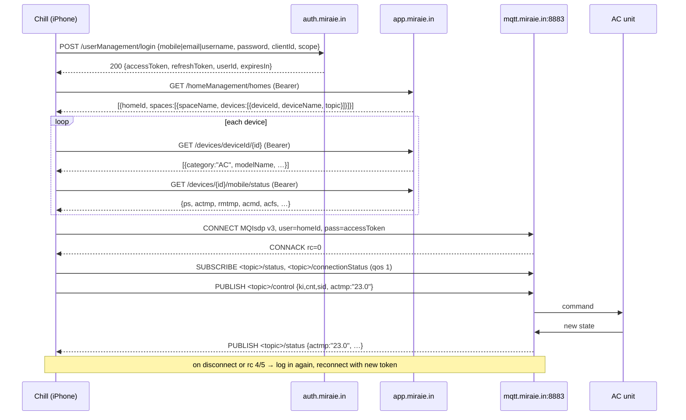

<!-- learn-sources: src/lib/miraie/auth.ts src/lib/miraie/rest.ts src/lib/miraie/messages.ts src/lib/miraie/status.ts src/lib/miraie/mqtt/session.ts src/lib/miraie/live-backend.ts -->

# How Chill talks to a MirAIe AC

Panasonic MirAIe has no public API. Everything here comes from the open-source
[Panasonic-MirAIe-MCP-Server](https://github.com/painful-bug/Panasonic-MirAIe-MCP-Server)
(`api.py`, `broker.py`, `device.py`, `constants.py`, `enums.py`), which in turn mirrors the
official app, plus a probe of the broker from this repo's laptop on 2026-10-16.
The code that implements it is listed in the `learn-sources` comment at the top (CHILL-002);
when one of those files changes, re-check this page. `pnpm spike:miraie` exercises it against
your own account.

There are two channels:

- **REST** over HTTPS: sign in, list the home's devices, read a device's current status.
- **MQTT 3.1** over TLS: send commands and receive live status pushes.

## End to end

1. **Sign in.** `POST https://auth.miraie.in/simplifi/v1/userManagement/login` with the login id
   under a key chosen by its shape (`email` if it has `@`, `mobile` if it's digits, else
   `username`), the password, the public app `clientId` and a random `scope`. The reply holds an
   `accessToken` (also the MQTT password), a `refreshToken`, the `userId` and `expiresIn`.
   401 = wrong credentials, 412 = mobile number not registered with MirAIe.
2. **Find the home and its devices.** `GET https://app.miraie.in/simplifi/v1/homeManagement/homes`
   with `Authorization: Bearer <accessToken>`. The library takes the **first** home; its
   `spaces[]` are rooms (`spaceName`), each with `devices[]` (`deviceId`, `deviceName`,
   `topic[0]`).
3. **Keep only ACs.** For each device, `GET …/deviceManagement/devices/deviceId/{deviceId}`
   returns details (`category`, `modelName`, `brand`, `firmwareVersion`, …). Devices whose
   `category` isn't `ac` are skipped.
4. **Read the starting status.** `GET …/deviceManagement/devices/{deviceId}/mobile/status`
   returns the status object (keys below). Chill puts it in the TanStack Query cache.
5. **Connect to the broker.** TLS to `mqtt.miraie.in:8883`, MQTT 3.1 (`MQIsdp`, level 3),
   clean session false, `username` = `homeId`, `password` = `accessToken`,
   `clientId` = `an` + 16 random digits + 5 random digits.
6. **Subscribe** (qos 1) to `<topic>/status` and `<topic>/connectionStatus` for every AC.
7. **Send a command** by publishing JSON to `<topic>/control`: the base
   `{ "ki": 1, "cnt": "an", "sid": "1" }` plus the keys for that control.
8. **Receive the result.** The AC answers on `<topic>/status` with its new state (often only the
   keys that changed). Chill merges it into the cached status, so every screen updates.
   `<topic>/connectionStatus` carries `onlineStatus` alone when the AC goes on/offline.
9. **Reconnect.** On an unexpected disconnect or a refused CONNACK (rc 4/5, expired token), Chill
   signs in again with the stored credentials and reconnects with the new access token.



## Payloads

Login request (mobile number):

```json
{
  "clientId": "PBcMcfG19njNCL8AOgvRzIC8AjQa",
  "password": "••••••••",
  "scope": "an483920175",
  "mobile": "9876543210"
}
```

Status (REST, or an MQTT push):

```json
{
  "onlineStatus": "true",
  "ps": "on",
  "actmp": "24.0",
  "rmtmp": "27.0",
  "acmd": "cool",
  "acfs": "auto",
  "acdc": "on",
  "acpm": "off",
  "acem": "off",
  "acvs": 3,
  "achs": 0
}
```

| Key            | Meaning                     | Values                                        |
| -------------- | --------------------------- | --------------------------------------------- |
| `ps`           | power                       | `on` / `off`                                  |
| `actmp`        | target °C                   | string number, 16–30                          |
| `rmtmp`        | room °C                     | string number                                 |
| `acmd`         | mode                        | `cool` `auto` `dry` `fan` `heat`              |
| `acfs`         | fan                         | `auto` `quiet` `low` `medium` `high`          |
| `acdc`         | indoor display              | `on` / `off`                                  |
| `acpm`         | powerchill                  | `on` / `off`                                  |
| `acem`         | eco                         | `on` / `off`                                  |
| `acvs`, `achs` | vertical / horizontal swing | `0` = swing (auto), `1`–`5` = fixed positions |
| `onlineStatus` | reachable                   | `"true"` / `"false"`                          |

Commands (`<topic>/control`):

```json
{ "ki": 1, "cnt": "an", "sid": "1", "ps": "off" }
{ "ki": 1, "cnt": "an", "sid": "1", "actmp": "23.0" }
{ "ki": 1, "cnt": "an", "sid": "1", "acmd": "dry" }
{ "ki": 1, "cnt": "an", "sid": "1", "acfs": "quiet" }
{ "ki": 1, "cnt": "an", "sid": "1", "acvs": 2 }
{ "ki": 1, "cnt": "an", "sid": "1", "acem": "on", "acpm": "off", "actmp": 26 }
{ "ki": 1, "cnt": "an", "sid": "1", "acpm": "on", "acem": "off" }
```

Eco always sets 26° and turns powerchill off; powerchill turns eco off. The Climate board shows
the same rule ("Holds 26°").

## Why the phone needs a dev build

Probe from this repo, 2026-10-16:

- `mqtts://mqtt.miraie.in:8883` answers MQTT 3.1 and refuses fake credentials with CONNACK rc 4
  ("Bad username or password"). The certificate is `CN=app.miraie.in.panasonic.com`, issued by
  Amazon — so normal TLS verification works.
- No MQTT-over-WebSocket endpoint was found: 443 is intercepted by Zscaler on this laptop and
  hangs up; 8083, 8084, 8884, 9001, 8443 and 80 never answered.

So the app must open a raw TLS socket, which React Native can only do through a native module
(`react-native-tcp-socket`). Expo Go can't load it; the app needs a development build. The MQTT
client is a small hand-written MQTT 3.1 codec (CONNECT, CONNACK, SUBSCRIBE, SUBACK, PUBLISH,
PUBACK, PINGREQ/PINGRESP, DISCONNECT): mqtt.js can't open raw TLS sockets in React Native and
`mqtt-packet` pulls in Node's stream stack. Tests check our codec against `mqtt-packet` and run
the session against a real `aedes` broker.

The web preview and Expo Go use the demo backend (`EXPO_PUBLIC_MIRAIE_DEMO=1`), an in-memory
MirAIe that answers like the real one.

## What we don't know

- **Schedules and timers.** The MCP server's `set_timer` / `set_schedule` are in-memory asyncio
  tasks on whatever machine runs it — there is no known server-side MirAIe schedule API. The
  Schedules board (CHILL-009) needs a decision before it can work with the phone locked or off.
- **Token refresh.** A `refreshToken` comes back, but no refresh endpoint is known; Chill signs
  in again with the stored password instead.
- **More than one home.** The library always uses `homes[0]`.
- **Token lifetime.** `expiresIn` is returned; how the broker reacts when it lapses mid-session
  is only known from the library's behaviour (disconnect → re-login).
